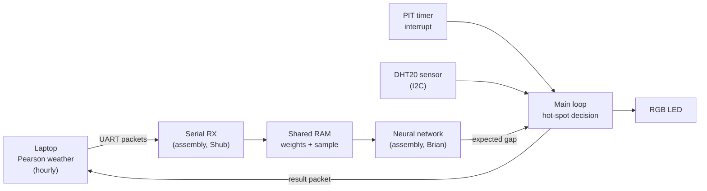

# Block Temperature: an urban heat island node on the FRDM-K64F

SEH500 (Microprocessors) final project, Fall 2026. Brian Wu and Shubkarman.

A FRDM-K64F board with a temperature and humidity sensor measures one city block. Pearson Airport's weather arrives from a laptop over serial. A small neural network, written in ARM assembly, predicts how much warmer than Pearson the block *should* be right now. If the block is clearly hotter than that, the board flags it as a hot spot and turns the LED red.

## Who writes what

These are the parts we can choose to write ourselves. Each of us owns one assembly block, because the professor asks about the code we wrote.

| Part | Language | Owner | Notes |
|---|---|---|---|
| Neural network inference: input scaling, 3 dense layers, ReLU, output scaling | Assembly | Brian | The required 100+ line functional block. Must match `test_vectors.csv` exactly. |
| Serial receive: RX interrupt handler, ring buffer, packet parser, XOR checksum | Assembly | Shub | Second assembly block. Fills the shared buffers below. |
| UART register setup (clock gate, pin mux, baud rate, NVIC) | Assembly | Open (stretch) | Default is C via the SDK. |
| DHT20 sensor driver over I2C | C | Open | |
| PIT timer interrupt and RGB LED status | C | Open | |
| C reference version of the network (for checking and speed comparison) | C | Open | |
| Main loop: hot-spot decision | C | Open | |
| PC sender script (weights + Pearson samples) | Python | Open | |

> **Notice:** every part not claimed by Brian or Shub in this table (including any "Open" row nobody takes) will be written with AI assistance (Claude), as the course allows. The model training and export scripts are AI-written too. Each AI-assisted file says so in its header comment, and the report lists them in the GenAI declaration.

## Contents

1. [The problem](#the-problem)
2. [How it works](#how-it-works)
3. [Hardware and peripherals](#hardware-and-peripherals)
4. [Dataset](#dataset)
5. [The neural network](#the-neural-network)
6. [Fixed-point format (Q4.11)](#fixed-point-format-q411)
7. [Serial protocol](#serial-protocol)
8. [Shared memory contract](#shared-memory-contract)
9. [Course requirements checklist](#course-requirements-checklist)
10. [Plan and timeline](#plan-and-timeline)
11. [Open questions](#open-questions)
12. [References](#references)

## The problem

Cities are warmer than the countryside around them, mostly at night, because concrete and asphalt store heat during the day and release it after sunset. This is the **urban heat island**. Within a city some blocks are much worse than others, and those blocks are where heat waves hurt people most.

Weather stations are usually at airports, outside the city. So the official temperature (Pearson) doesn't tell you how hot a particular block is. One cheap sensor per block could, but a raw reading isn't enough: downtown is *normally* a bit warmer than Pearson, and how much warmer depends on the time of day, the season and the weather. To call a block a hot spot, the node needs to know what "normal" looks like right now.

UN Sustainable Development Goals: **SDG 11** (sustainable cities and communities), **SDG 13** (climate action) and **SDG 3** (good health, since heat waves are a health risk).

## How it works



Every sample period:

1. The PIT timer interrupt sets a flag.
2. The main loop reads the block temperature from the DHT20.
3. The latest Pearson sample (temperature, humidity, wind, hour, day of year) is already in RAM, put there by the serial parser.
4. The network predicts the **expected gap**: how much warmer than Pearson this block normally is under these conditions.
5. The **measured gap** is block temperature − Pearson temperature.
6. If measured gap − expected gap > threshold (starting value 1.5 °C, tunable), it's a hot spot.

| LED | Meaning |
|---|---|
| Green | Normal |
| Red | Hot spot |
| Blue | Waiting for weights or Pearson data |

We build it in three steps, each one a working version:

1. **Subtraction:** expected gap = 0. Any block warmer than Pearson by more than the threshold is flagged.
2. **Hourly table:** expected gap = the average gap for this hour of day (24 numbers).
3. **Neural network:** expected gap from the network.

## Hardware and peripherals

| Part | Use |
|---|---|
| NXP FRDM-K64F (Cortex-M4F, 120 MHz) | The board |
| SparkFun Humidity and Temperature Sensor Breakout, DHT20 (SPX-18364) | Block temperature and humidity, over I2C |
| 4.7 kΩ resistors (×2) | I2C pull-ups on SDA and SCL, if the breakout doesn't have them |
| Breadboard and jumper wires | |
| USB cable | Power, programming and serial (OpenSDA virtual COM port) |

**Peripherals used (the course asks for at least 3):**

1. **UART**, both sending and receiving: Pearson data and weights in, results out.
2. **I2C**: the DHT20 sensor.
3. **GPIO**: the RGB LED.
4. **PIT timer**: the sampling interrupt.

**DHT20 notes (from memory, to check against the datasheet):** I2C address 0x38, power from 3.3 V. To measure, send 0xAC 0x33 0x00, wait about 80 ms, then read 7 bytes. Humidity and temperature are 20-bit raw values divided by 2²⁰.

## Dataset

Environment and Climate Change Canada (ECCC) historical hourly data, 2014–2025, free and public.

| Station | ID | Role |
|---|---|---|
| TORONTO INTL A (Pearson Airport) | 51459 | The "official" weather: network inputs |
| TORONTO CITY (downtown, University of Toronto) | 31688 | Stands in for "the block": the training target |

- Search page: https://climate.weather.gc.ca/historical_data/search_historic_data_e.html
- Bulk CSV download, one month per file:
  `https://climate.weather.gc.ca/climate_data/bulk_data_e.html?format=csv&stationID=<ID>&Year=<Y>&Month=<M>&Day=1&timeframe=1&submit=Download+Data`
- Columns used: `Date/Time (LST)`, `Temp (°C)`, `Rel Hum (%)`, `Wind Spd (km/h)`. The downtown station has no wind data, which is fine because only Pearson's wind is used.
- After joining the stations by hour and dropping missing rows: **104,766 hours**.

**What the data shows:**

- Downtown is warmer than Pearson by **+0.58 °C on average** (standard deviation 1.14 °C).
- The gap is about **+1.1 °C at night** and about **0 °C in the afternoon**.
- It is biggest in **winter** (+1.13 °C) and smallest in **summer** (+0.07 °C). On spring and summer afternoons downtown is often *cooler*, probably from the lake breeze.
- **The colder it is at Pearson, the bigger the gap:** about +2 °C on −15 °C nights, and negative on 30 °C afternoons.
- **Known inconsistency:** our proposal said calm summer nights show the biggest gap. The data doesn't support that (calm summer nights average +0.18 °C). The report will say so.

**Backup datasets** if we need another city: NYC Hyperlocal Temperature Monitoring (https://data.cityofnewyork.us/d/qdq3-9eqn) with NOAA Local Climatological Data for the airport side.

## The neural network

**Inputs (7),** all from Pearson or the clock. The block sensor is *not* an input: the network predicts what's normal, and the sensor is compared against it.

| # | Input | How the board gets it |
|---|---|---|
| 0 | Pearson temperature | Serial, in tenths of °C |
| 1 | Pearson relative humidity | Serial, in tenths of % |
| 2 | Pearson wind speed | Serial, in tenths of km/h |
| 3, 4 | sin and cos of 2π·hour/24 | Table lookup by hour (24 entries) |
| 5, 6 | sin and cos of 2π·day/365 | Table lookup by day of year (366 entries) |

Sine and cosine together let the network know that 23:00 is next to 00:00, and December 31 is next to January 1.

**Target (1):** the gap, downtown temperature − Pearson temperature.

**Architecture:** 7 → 16 → 8 → 1, fully connected, ReLU on the hidden layers and no activation on the output (the gap can be negative). That's 273 numbers (128 + 136 + 9), 546 bytes as int16. On the board it's one dense-layer routine called three times.

**Training:**

- Split by year, never randomly: train 2014–2022, validate 2023, test 2024–2025.
- Inputs and target standardized with z = (x − mean) / std, using training years only. Inputs are clipped to ±4.
- scikit-learn `MLPRegressor(hidden_layer_sizes=(16, 8), activation="relu", early_stopping=True, random_state=0)`.

**Results (average error, °C):**

| Model | Validation (2023) | Test (2024–25) |
|---|---|---|
| No heat island (gap = 0) | 0.966 | 1.014 |
| Hourly average | 0.723 | 0.789 |
| Network, float | 0.592 | 0.618 |
| **Network, int16 (what the board runs)** | **0.593** | **0.620** |

We also tried 7-8-1, 7-16-1, 7-8-8-1 and 7-32-16-1. All landed between 0.607 and 0.620 °C, so 7-16-8-1 is a middle size, big enough to be interesting in assembly and small enough to fit easily.

**Exported files** (to be added under `model/`):

| File | Contents |
|---|---|
| `weights.bin` | 556 bytes: int16 little-endian header `[3, 7, 16, 8, 1]`, then W1 b1 W2 b2 W3 b3. Each W is (out, in), row-major. |
| `model.h` | The same numbers as C arrays, plus the scaling constants and time tables. |
| `scaling.json` | The integer constants for input and output scaling. |
| `test_vectors.csv` | 22 test hours with every intermediate value (inputs, layer 1, layer 2, output). The board must match these exactly. |

## Fixed-point format (Q4.11)

The board runs the network with integers only: no floats, no division.

- Every weight, bias and activation is an **int16** in **Q4.11**: real value = integer / 2048. Range about ±16, step about 0.0005.
- A dense layer computes, for each output neuron: `acc = Σ x[i]·W[o][i] + (b[o] << 11)` in a 32-bit register. Products of two Q4.11 numbers are Q8.22, so the bias is shifted left by 11 to line up.
- Then `asr` by 11 to get back to Q4.11, saturate to the int16 range, and apply ReLU on hidden layers.
- Load weights with `ldrsh` (signed), not `ldrh`.
- Checked in Python: the biggest accumulator value on the whole dataset is about 27 million, far from the int32 limit of 2.1 billion. No activation ever hits the int16 limit.

**Input scaling** (raw tenths → Q4.11): `x = clamp(((raw10 − M10) × K) >> 16, −8192, 8192)`. M10 and K are integers precomputed in Python, so the board only does subtract, multiply and shift.

**Output scaling** (Q4.11 → tenths of °C): `gap10 = ((y × KO) >> 16) + MO10`.

## Serial protocol

The UART runs over the OpenSDA USB virtual COM port. Every packet:

| Byte(s) | Field |
|---|---|
| 0 | Start byte `0xAA` |
| 1 | Type (ASCII) |
| 2–3 | Payload length, little-endian uint16 |
| 4 … 4+len−1 | Payload |
| last | Checksum: XOR of the type, both length bytes and every payload byte |

| Type | Direction | Payload |
|---|---|---|
| `'W'` | PC → board | `weights.bin` as is (556 bytes) |
| `'S'` | PC → board | Pearson sample: 5 × int16 (temp10, rh10, wind10, hour, day of year), 10 bytes |
| `'R'` | board → PC | Result: block temp10, expected gap10, measured gap10, hot-spot flag |

A packet with a bad checksum or the wrong length is dropped. The parser then looks for the next `0xAA`.

## Shared memory contract

The two assembly blocks never call each other. They only share these buffers, so each of us can build and test our half alone.

```c
extern int16_t nn_weights[5 + 273];   // filled from a 'W' packet; header first
extern volatile int16_t pearson[5];   // filled from an 'S' packet
extern volatile uint8_t sample_ready; // parser sets 1; main loop clears it
```

The network is called from C following the ARM calling convention (AAPCS): arguments in r0–r3, result in r0, r4–r11 saved by the function.

```c
int16_t nn_predict(const int16_t *weights, const int16_t *pearson, int16_t *scratch);  // returns gap10
```

## Course requirements checklist

| Requirement | How we meet it |
|---|---|
| At least 100 lines of GNU assembly as one functional block | Neural network inference (plus the serial parser as a second block) |
| At least one interrupt | PIT timer and UART RX |
| At least 3 peripherals (serial counts only if it sends and receives) | UART (both ways), I2C, GPIO, PIT |
| Tied to a UN SDG | SDG 11, 13 and 3 |
| Report (1500 words max), code on GitHub, slides | Due Mon Dec 7, 11:59 PM |
| 5-minute presentation with live demo | Dec 8 or Dec 11 |

## Plan and timeline

| Date | Work |
|---|---|
| Mon Nov 23 | Train, quantize and export the model (done) |
| Wed Nov 25 | DHT20 over I2C, readings printed over UART |
| Thu Nov 26 | PIT timer, UART packets, LED |
| Sat Nov 28 | Assembly dense layer, plus the C reference |
| Sun Nov 29 | Assembly input scaling; match the test vectors |
| Mon Nov 30 | Integrate: weights over serial, full loop (subtraction → table → network) |
| Tue Dec 1 | Test on held-out data; cycle counts, assembly vs C |
| Wed Dec 2 | Demo build and bug-fix buffer |
| Sat Dec 5 | Report draft and slides |
| Sun Dec 6 | GitHub cleanup, demo rehearsal |
| Mon Dec 7 | Final review and submit |

**Demo idea:** the laptop replays real past Pearson hours. Warm the sensor with a hand or a hair dryer and the LED goes red; cool it with an ice pack and it goes back to green.

**Planned repo layout:**

```
firmware/     MCUXpresso project: C sources and the two .s assembly files
model/        Exported weights, scaling constants and test vectors
training/     Python: data download, training and export
tools/        Python: PC sender for weights and Pearson samples
docs/         Charts, diagrams and the report
```

## Open questions

- Which day is our in-class presentation, Dec 8 or Dec 11?
- Does the professor expect *each* partner to write assembly, or just the project as a whole?
- Who takes the "Open" rows in the table at the top?
- What sample period should the PIT use for the demo (for example every 2 seconds), and what threshold makes a good demo?

## References

1. Environment and Climate Change Canada, "Historical Climate Data." https://climate.weather.gc.ca/
2. NXP, *FRDM-K64F Freedom Module User's Guide* and *K64 Sub-Family Reference Manual*.
3. Aosong, *DHT20 Temperature and Humidity Module* datasheet.
4. ARM, *Procedure Call Standard for the Arm Architecture (AAPCS)*.
5. scikit-learn, `MLPRegressor`. https://scikit-learn.org/stable/modules/generated/sklearn.neural_network.MLPRegressor.html
6. United Nations, "The 17 Goals." https://sdgs.un.org/goals
